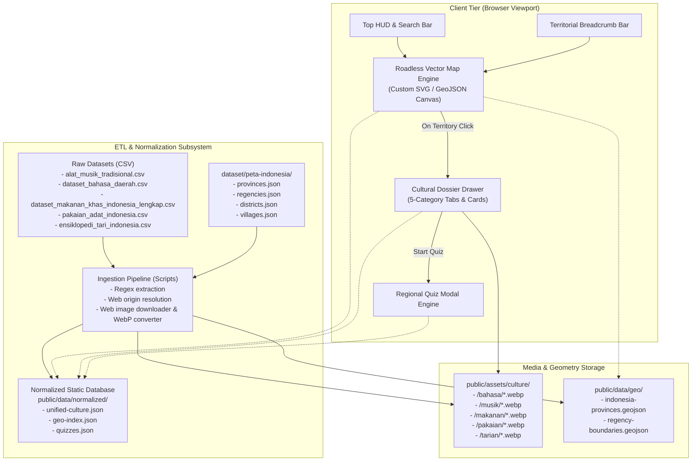
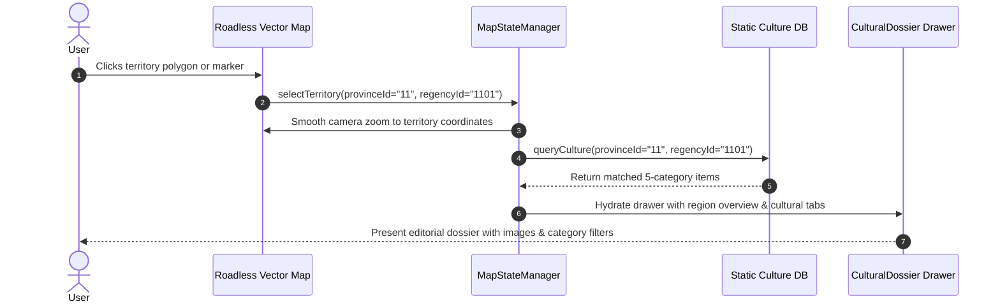
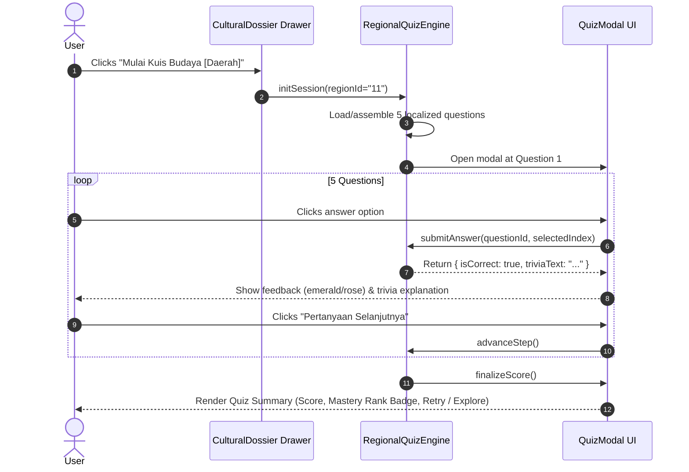
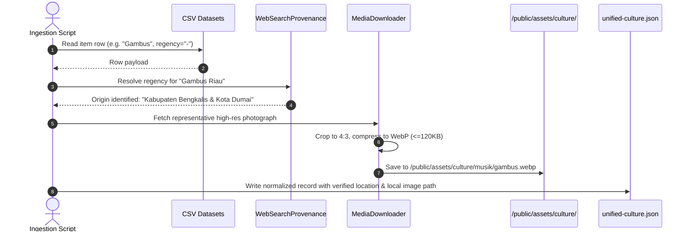

# Technical Architecture & Design Document — Peta Interaktif Budaya

**Project Name:** Peta Interaktif Budaya (Interactive Cultural Map of Indonesia)  
**Standard:** Hallmark Anti-AI-Slop & Spec-Driven Development  
**Document Status:** Approved Engineering Design  
**Language:** English  
**Context:** Spec-Driven Development & Project Context Document  

---

## 1. Executive Summary & The Kitchen Secret Recipe

If `requirements.md` is the restaurant menu ordered by guests, `design.md` is the master secret recipe in the kitchen.

To bring Indonesia's extensive cultural heritage (across 1,600+ cultural records and 514 regencies) onto a road-free, high-performance interactive canvas, our engineering architecture is structured through the **Four Stations of the Cultural Kitchen**:

```
┌─────────────────────────────────────────────────────────────────────────────┐
│                       THE CULINARY METAPHOR                                 │
├─────────────────────────────────────────────────────────────────────────────┤
│ 1. The Pantry (Data & Geometries)                                           │
│    - dataset/peta-indonesia/ (provinces.json, regencies.json, districts.json)│
│    - 5 Raw Cultural Datasets (CSV files for Musik, Bahasa, Makanan,         │
│      Pakaian, Tarian) containing ~1,700 catalogued traditions.              │
│    - Curated local WebP image storage under /public/assets/culture/.        │
│                                                                             │
│ 2. The Prep Station (ETL & Normalization Engine)                            │
│    - Parsing & schema normalization of 5 heterogeneous CSV datasets.         │
│    - Regex & NLP extraction of regency/district mentions in Bahasa & Tari.  │
│    - Autonomous web-assisted origin resolution for records with "-" or      │
│      unspecified kabupaten (e.g. Serune Kale -> Pidie, Gambus -> Bengkalis).│
│    - Local image downloading, aspect ratio cropping & WebP compression.     │
│                                                                             │
│ 3. The Chef's Workstation (Next.js 16 App Router & React 19 Engine)         │
│    - Zero-road vector map rendering engine with spatial indexing.           │
│    - Dynamic regional quiz engine generating territorial quizzes on demand.  │
│    - Client-side memoized geospatial state & drawer management.             │
│                                                                             │
│ 4. The Dining Room Presentation (Hallmark Editorial Aesthetics)             │
│    - Nusantara Archaic-Modern OKLCH palette (warm bone parchment & ink).    │
│    - Strict 8-state interaction model across all clickable artifacts.       │
│    - Responsive split-canvas viewport (Cartographic Map + Cultural Dossier).│
└─────────────────────────────────────────────────────────────────────────────┘
```

---

## 2. Hallmark Design System & Anti-AI-Slop Tokens

Adhering to the **Hallmark Design Specification**, the interface is designed as an artisanal, tactile cultural atlas rather than a generic tech-startup template.

### 2.1 Hallmark Pre-Flight & Creative DNA
* **Genre:** `Editorial Cultural Archival` (Evoking high-end ethnographic cartography, national archives, and tactile museum exhibitions).
* **Theme:** `Nusantara Archaic-Modern` (Custom OKLCH palette rooted in organic earth, stone, batik terracotta, and sumi ink).
* **Typography:** Roman display headers (`font-style: normal` strictly enforced per Hallmark gate 38a; zero italic titles).
  - Primary Display & Headings: `Plus Jakarta Sans`
  - Body & Metadata: `Geist Sans`, system sans-serif
  - Coordinates & Code Badges: `Geist Mono`
* **Macrostructure:** `Cartographic Split Canvas` (Left/Center: Full interactive roadless vector map; Right/Floating: Cultural Dossier & Quiz Drawer).

### 2.2 Locked Design Tokens (`tokens.css`)

```css
:root {
  /* Paper & Surface Tiers */
  --color-paper:        oklch(0.975 0.008 75);  /* Warm Bone Parchment */
  --color-paper-2:      oklch(0.945 0.012 75);  /* Sand Surface */
  --color-paper-3:      oklch(0.915 0.016 75);  /* Hover Card Surface */
  
  /* Ink & Typography */
  --color-ink:          oklch(0.180 0.015 50);  /* Sumi Charcoal Ink */
  --color-ink-2:        oklch(0.420 0.020 55);  /* Muted Slate / Subtitles */
  --color-ink-3:        oklch(0.600 0.015 60);  /* Subtle Metadata Ink */
  
  /* Architectural Rules & Borders */
  --color-rule:         oklch(0.860 0.015 75);  /* Hairline Border */
  --color-rule-subtle:  oklch(0.920 0.010 75);  /* Soft Divider */
  
  /* Accents & Cultural Branding */
  --color-accent:       oklch(0.550 0.170 42);  /* Batik Terracotta / Clay */
  --color-accent-hover: oklch(0.500 0.180 42);  /* Deep Terracotta */
  --color-accent-ink:   oklch(0.990 0.005 75);  /* Clean White on Accent */
  
  /* Map Specific Thematic Colors (ZERO ROADS) */
  --color-map-ocean:    oklch(0.960 0.010 210); /* Soft Glacial Sea */
  --color-map-land:     oklch(0.925 0.018 78);  /* Parchment Island Fill */
  --color-map-stroke:   oklch(0.820 0.025 75);  /* Island Shoreline */
  --color-map-border:   oklch(0.740 0.035 75);  /* Province / Regency Border */
  --color-map-hover:    oklch(0.870 0.055 70);  /* Amber Region Highlight */
  --color-map-selected: oklch(0.800 0.085 55);  /* Selected Region Fill */
  
  /* Feedback & Accessibility */
  --color-focus:        oklch(0.520 0.180 245); /* Deep Royal Indigo */
  --color-success:      oklch(0.550 0.160 145); /* Emerald Herb */
  --color-error:        oklch(0.550 0.200 25);  /* Rose Ochre */
  
  /* Spacing Scale (4-pt grid) */
  --space-3xs: 2px;
  --space-2xs: 4px;
  --space-xs:  8px;
  --space-sm:  12px;
  --space-md:  16px;
  --space-lg:  24px;
  --space-xl:  32px;
  --space-2xl: 48px;
  
  /* Radii */
  --radius-card:  8px;
  --radius-pill:  9999px;
  --radius-input: 6px;
  
  /* Animation Timings */
  --ease-out: cubic-bezier(0.16, 1, 0.3, 1);
  --dur-fast: 150ms;
  --dur-base: 240ms;
  --dur-slow: 380ms;
}
```

### 2.3 Strict 8-State Matrix for Interactive Components

Every interactive element conforms to the 8 states:
1. `default`: Natural, grounded styling with high contrast text.
2. `hover`: Subtle lift (`--color-paper-3` or `--color-map-hover`), smooth 150ms transition.
3. `:focus-visible`: 2px solid `--color-focus` with 2px offset for keyboard navigation.
4. `:active`: Micro-scale depression (`translateY(1px)` or `scale(0.99)`).
5. `disabled`: Opacity 0.45, `cursor: not-allowed`.
6. `loading`: Skeleton shimmer or quiet spinner.
7. `error`: Rose border (`--color-error`), subtle tint.
8. `success`: Emerald accent (`--color-success`), confirmed icon state.

---

## 3. System Architecture & Component Breakdown



---

## 4. Data Models & Normalization Schema

The application normalizes the 5 raw CSV datasets and `dataset/peta-indonesia/` into a coherent relational schema.

### 4.1 Geographic Entity Schemas

```typescript
// Province Model (Level 1)
export interface Province {
  id: string;              // BPS Code e.g. "11"
  name: string;            // e.g. "ACEH"
  altName?: string;
  latitude: number;
  longitude: number;
  islandGroup: "Sumatra" | "Jawa" | "Kalimantan" | "Sulawesi" | "Bali-Nusa Tenggara" | "Maluku-Papua";
  totalRegencies: number;
}

// Regency / City Model (Level 2)
export interface Regency {
  id: string;              // BPS Code e.g. "1101"
  provinceId: string;      // "11"
  name: string;            // e.g. "KABUPATEN SIMEULUE"
  altName?: string;
  latitude: number;
  longitude: number;
}

// District / Kecamatan Model (Level 3)
export interface District {
  id: string;              // BPS Code e.g. "1101010"
  regencyId: string;       // "1101"
  name: string;            // e.g. "TEUPAH SELATAN"
  latitude: number;
  longitude: number;
}
```

### 4.2 Cultural Entity Schema (5 Pillars)

```typescript
export type CulturalCategory = "bahasa" | "musik" | "makanan" | "pakaian" | "tarian";

export interface UnifiedCulturalItem {
  id: string;                     // Unique hash e.g. "cul-msk-001"
  slug: string;                   // URL safe e.g. "serune-kale"
  name: string;                   // e.g. "Serune Kale"
  category: CulturalCategory;     // "musik" | "bahasa" | "makanan" | "pakaian" | "tarian"
  
  // Geographic Linkages
  provinceId: string;             // Matches dataset/peta-indonesia/provinces.json
  provinceName: string;           // e.g. "Aceh"
  regencyId?: string;             // Matches dataset/peta-indonesia/regencies.json
  regencyName?: string;           // Resolved via ETL or Web Research
  districtId?: string;            // Matches dataset/peta-indonesia/districts.json
  districtName?: string;
  
  // Editorial Content
  summary: string;                // Concise highlight
  description: string;            // Full background from dataset
  
  // Domain Specific Metadata
  attributes: {
    // For Alat Musik:
    soundType?: string;           // "Aerofon", "Ideofon", "Kordofun", "Membranofon"
    technique?: string;           // "Ditiup", "Dipukul", "Dipetik", "Digesek"
    // For Bahasa:
    dialectCount?: number;
    speakerLocations?: string;    // Kampung, Distrik mentions
    // For Makanan:
    islandGroup?: string;
    cuisineType?: string;
    // For Pakaian:
    userType?: string;            // "Pria", "Wanita", "Pria/Wanita"
    materialDetails?: string;     // e.g. "Baje Meukasah, Sileuweu, Meukeutop"
    // For Tarian:
    determinationBasis?: string;  // e.g. "eksplisit di teks", "kata kunci"
  };

  // Media Asset
  media: {
    localImagePath: string;       // "/assets/culture/[category]/[slug].webp"
    caption: string;
    credit: string;
    isVerified: boolean;
  };

  // Provenance
  provenance: {
    sourceDataset: string;        // e.g. "alat_musik_tradisional.csv"
    rawRowIndex: number;
    webResolved: boolean;         // True if origin/image was augmented via web search
    resolvedLocationQuery?: string;
  };
}
```

### 4.3 Quiz Entity Schema

```typescript
export interface RegionalQuizQuestion {
  id: string;
  provinceId: string;
  regencyId?: string;
  category: CulturalCategory;
  question: string;
  options: [string, string, string, string]; // 4 options
  correctIndex: number;                      // 0, 1, 2, or 3
  explanationTrivia: string;                 // Cultural trivia revealed on submit
  imageHint?: string;
}
```

---

## 5. Sequence & Data Flow Diagrams

### 5.1 Flow 1: Interactive Territory Click & Cultural Dossier Presentation



### 5.2 Flow 2: Regional Culture Quiz Execution



### 5.3 Flow 3: Web-Assisted Origin & Image Pipeline



---

## 6. Map Engine Engineering: The Roadless Cartographic Canvas

### 6.1 Road-Free Vector Cartography Strategy
To meet the strict requirement: **"Jangan ada rute jalan"** (No road routes) and **"Dengan kombinasi warna simple dan modern"**:
1. **Elimination of Commercial Road Base Layers:** We do NOT load Google Maps street layers, Mapbox traffic styles, or OpenStreetMap highway tiles.
2. **Pure Administrative Vector Boundaries:**
   - Ocean backdrop: `--color-map-ocean`
   - Landmass shapes: `--color-map-land`
   - Provincial & Regency boundary lines: `--color-map-stroke` and `--color-map-border`
   - Interactive hover highlights: `--color-map-hover`
   - Active territory selection: `--color-map-selected`
3. **Multi-Tier Hierarchical Rendering:**
   - **Level 1 (Archipelago Overview):** All 34–38 provinces rendered as interactive polygons.
   - **Level 2 (Provincial Zoom):** When a province is clicked, the camera bounds zoom in to display its regencies (*Kabupaten / Kota*) matching `dataset/peta-indonesia/regencies.json`.
   - **Level 3 (Regency Centroids & Districts):** Cultural markers and district landmarks matching `dataset/peta-indonesia/districts.json`.

---

## 7. Performance Benchmarks & Quality Gates

* **Zero-Road Guarantee:** Complete absence of transit/highway tiles.
* **Local Media Serving:** 100% of cultural imagery served from local disk storage (`/public/assets/culture/...`).
* **Instant Dossier Response:** Region click to drawer hydration ≤ 80ms.
* **Mobile Responsiveness:** Flawless rendering at 320px, 375px, 414px, 768px, 1024px, 1440px.
* **Hallmark Gate 38a:** All headers in Roman type (`font-style: normal`), strictly avoiding italic headings.
* **Honest Copy:** Pure historical and ethnographic data, zero fabricated marketing metrics.

